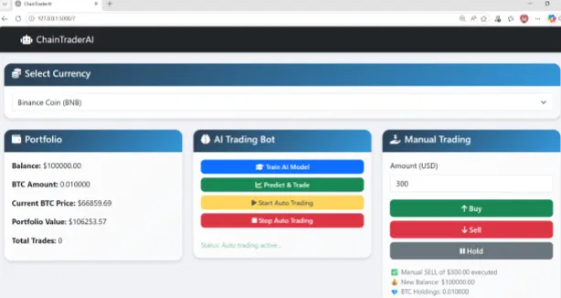
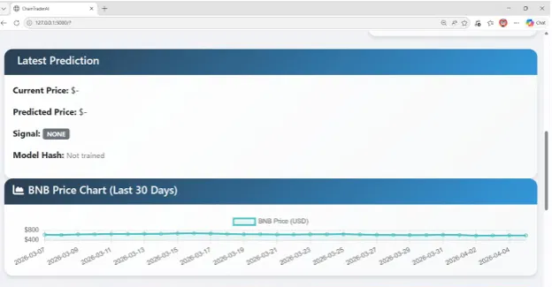
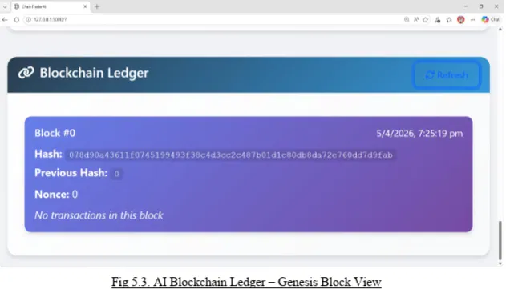

# ChainTraderAI — AI-Powered Blockchain-Based Crypto Trading Bot

ChainTraderAI is a **paper-trading** crypto bot that combines an **LSTM price-prediction model** with a **SHA-256 proof-of-work ledger**. Every trade is recorded as a block together with a hash of the AI model version that produced it, so each decision can be traced and verified. A Flask web dashboard lets you train models, run the bot, trade manually, and inspect the ledger.

Presented at **ICNTE 2026** (6th Biennial International Conference on Nascent Technologies in Engineering, IEEE & IAS technically co-sponsored) — *Paper ID 299*.

> ⚠️ **Disclaimer:** This is an educational/research project. It uses simulated money only and does not connect to any exchange. Nothing here is financial advice, and model predictions should not be used for real trading decisions.

## Screenshots

| Dashboard | Prediction & price chart | Blockchain ledger |
|---|---|---|
|  |  |  |

## Features

- **LSTM price prediction** — 3-layer LSTM (Keras/TensorFlow) trained per coin on 1 year of daily data, using a 60-day look-back window.
- **BUY / SELL / HOLD signals** — generated from the gap between predicted and current price (±2% threshold).
- **Auto trading** — a background loop runs predict-and-trade every 60 seconds; each automated trade uses 10% of available balance (or holdings for sells).
- **Manual trading** — buy, sell, or hold a chosen USD amount.
- **Blockchain ledger** — each trade is mined into a block (proof-of-work, difficulty 2) containing the trade details, the model's predicted price, and the model hash. The chain is validated via `/api/blockchain`.
- **11 supported coins** — BTC, ETH, SOL, BNB, XRP, DOGE, ADA, AVAX, LINK, DOT, LTC (live data via Yahoo Finance, with a built-in fallback when offline).
- **Web dashboard** — portfolio, bot controls, latest prediction, 30-day price chart, and ledger viewer.

## Architecture

```
Data Fetcher (yfinance) → AI/LSTM Model → Trading Bot → Blockchain Ledger → Flask Dashboard
```

```
.
├── app.py                  # Flask app, REST API, portfolio and auto-trading loop
├── data/data_fetcher.py    # Price/history fetching (yfinance + fallback data)
├── models/
│   ├── ai_trader.py        # LSTM model, training, prediction, signals, model hash
│   └── blockchain.py       # Block, TradingBlockchain, proof-of-work, validation
├── templates/              # Jinja2 templates (base + dashboard)
├── static/                 # CSS and dashboard JavaScript
└── docs/screenshots/
```

## Getting started

**Requirements:** Python 3.10–3.12 (3.12 recommended). TensorFlow does not yet publish installable packages for Python 3.14.

```bash
git clone https://github.com/<your-username>/ChainTraderAI.git
cd ChainTraderAI

python -m venv venv
source venv/bin/activate        # Windows: venv\Scripts\activate
pip install -r requirements.txt

python app.py
```

Open <http://127.0.0.1:5000>.

**Typical flow**

1. Pick a currency.
2. Click **Train AI Model** and wait for training to finish.
3. Click **Predict & Trade** for a single prediction, or **Start Auto Trading** for continuous operation.
4. Watch trades appear in the **Blockchain Ledger**.

**Optional environment variables:** `HOST` (default `127.0.0.1`), `PORT` (default `5000`), `FLASK_DEBUG=1` (development only — never expose debug mode publicly).

## API overview

| Method | Endpoint | Purpose |
|---|---|---|
| GET | `/api/portfolio` | Balance, holdings, portfolio value |
| POST | `/api/set_symbol` | Switch active coin |
| POST | `/api/train_model` | Train LSTM for the active coin |
| POST | `/api/predict_and_trade` | Predict and execute the signal |
| POST | `/api/manual_trade` | Manual BUY / SELL / HOLD |
| POST | `/api/start_auto_trading`, `/api/stop_auto_trading` | Control the auto-trading loop |
| GET | `/api/historical_data` | Last 30 days of prices for the chart |
| GET | `/api/blockchain` | Ledger contents and validity check |

## Known limitations

- Portfolio, trained models, and the blockchain live **in memory** and reset when the server restarts.
- The ledger is a single-node, educational blockchain — tamper-evident, but not a distributed network.
- The model predicts from closing prices only, and no real-money backtesting or transaction fees are modelled.
- Single-user design; there is no authentication.

## Roadmap

Real exchange integration (Binance, Coinbase, Kraken), hybrid models (GRU / Transformers / reinforcement learning), persistent storage, smart-contract integration (Ethereum / Hyperledger), authentication, a mobile app, and cloud deployment.

## Author

Tanishka Sawant

## License

MIT — see [LICENSE](LICENSE).
